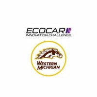

<div align="center">



# Where an engineering team can win in the software-defined vehicle market

**Western Michigan University · EcoCAR Innovation Challenge · Product Innovation Track**<br>
Studio 1 business portfolio · Check-In 1

### [▶ Open the live portfolio](https://menukaghalan.github.io/ecocar-portfolio-preview/)

`https://menukaghalan.github.io/ecocar-portfolio-preview/`

[Reading version](https://menukaghalan.github.io/ecocar-portfolio-preview/?mode=read) ·
[Slides (PDF)](https://menukaghalan.github.io/ecocar-portfolio-preview/downloads/portfolio.pdf) ·
[Full document (PDF)](https://menukaghalan.github.io/ecocar-portfolio-preview/downloads/portfolio-document.pdf) ·
[Evidence audit](https://menukaghalan.github.io/ecocar-portfolio-preview/downloads/fact-check-report.html)

</div>

---

## What this is

An interactive, self-guided portfolio that answers the Studio 1 brief: how value moves in software-defined vehicles (SDVs), how incumbents make money, where a student engineering team could fit, and the three wedge hypotheses we will test with real engineers in Studio 2.

It runs in any modern browser with no login and no install. Every market figure links to its public source, and the evidence audit lists how each claim was checked.

| | |
|---|---|
| **Deliverables covered** | Check-In 1 (B-1.3.1 to B-1.3.3) · Studio 1 (B-2.3.1 to B-2.3.4) |
| **Format** | 17 interactive slides, plus a reading version and two PDFs |
| **Sources** | Public sources only; no automaker or supplier data |
| **Last updated** | 20 Nov 2026 |

## Three ways to read it

| If you want to… | Use |
|---|---|
| Click through the story, with animations and pop-outs | **[Live portfolio](https://menukaghalan.github.io/ecocar-portfolio-preview/)** (best on a laptop or larger screen) |
| Read it like a document, top to bottom, with every table | **[Reading version](https://menukaghalan.github.io/ecocar-portfolio-preview/?mode=read)** (the **Read** button in the top bar) |
| Print it or read it offline | **[Slides PDF](https://menukaghalan.github.io/ecocar-portfolio-preview/downloads/portfolio.pdf)** or **[Full document PDF](https://menukaghalan.github.io/ecocar-portfolio-preview/downloads/portfolio-document.pdf)** |

## What is inside

| # | Slide | Chapter | Brief |
|---|---|---|---|
| 1 | Cover | Overview | |
| 2 | Executive summary | Overview | |
| 3 | How it is organized | Overview | |
| 4 | Why SDVs | 1 · The market | B-2.3.1 |
| 5 | Ecosystem | 1 · The market | B-2.3.1 |
| 6 | Value chain stages | 1 · The market | B-2.3.1 |
| 7 | Value chain (3D) | 1 · The market | B-2.3.1 |
| 8 | Where value grows | 1 · The market | B-2.3.1 |
| 9 | Business models | 2 · How incumbents make money | B-2.3.2 |
| 10 | How we narrowed | 3 · Where we fit | B-2.3.3 |
| 11 | Wedge hypotheses | 4 · Our wedges | B-2.3.4 |
| 12 | Who we will interview | 5 · Next steps | |
| 13 | Innovation in society | 5 · Next steps | |
| 14 | Risks and gaps | 5 · Next steps | |
| 15 | How you can help | 5 · Next steps | |
| 16 | Round 1 map | Appendix | |
| 17 | Evidence audit | Appendix | |

## Getting around

- **Next / previous:** the arrows at the bottom, or the <kbd>←</kbd> <kbd>→</kbd> keys (swipe on a phone)
- **Jump to a slide:** <kbd>O</kbd> opens the overview grid; <kbd>1</kbd>–<kbd>9</kbd> jump directly; <kbd>Home</kbd> / <kbd>End</kbd> go to the first or last slide
- **Search everything:** <kbd>/</kbd>
- **Fullscreen:** <kbd>F</kbd>
- **More detail:** most tiles, cards and 3D parts open a pop-out when clicked; small numbers next to figures open their source
- **3D slide (value chain):** drag to turn, hover to highlight, click for detail

## How the repository is organized

```
ecocar-portfolio-preview/
├── index.html          The portfolio itself (GitHub Pages serves this page)
├── app/                The code and content behind the slides
│   ├── data.js           All slide content, figures and source citations
│   ├── app.js            Slides, interactions, 3D scenes and the reading version
│   ├── assets.js         Icons and company logo references
│   └── deck.css          Styles and animations
├── assets/             Files the page loads
│   ├── fonts/            Inter, Inter Tight and JetBrains Mono (self-hosted)
│   ├── logos/            Company and team logos
│   ├── vendor/           three.js (r147) for the 3D value chain
│   └── og.png            Preview image used when the link is shared
├── docs/               Supporting documents linked from the slides
│   ├── bmc/              Business model canvases: Applied Intuition, dSPACE, Mobileye
│   └── personas/         Persona cards (fictional archetypes)
└── downloads/          Files to read or print offline
    ├── portfolio.pdf             The 17 slides, one per page
    ├── portfolio-document.pdf    The reading version as a document
    ├── fact-check-report.html    Evidence audit: every claim and how it was checked
    └── fact-check-report.md      The same audit as plain text
```

**Where to change things:** words and numbers live in `app/data.js`; layout and behaviour live in `app/app.js` and `app/deck.css`. There is no build step: edit, refresh the page, done.

## Run it on your own computer

```bash
git clone https://github.com/menukaghalan/ecocar-portfolio-preview.git
cd ecocar-portfolio-preview
```

Then open `index.html` in Chrome, Edge or Firefox. If your browser blocks local files, serve the folder instead:

```bash
python -m http.server 8000
# then visit http://localhost:8000
```

Add `?mode=read` to the address for the reading version, or `?export=1` for the print layout used to make the slides PDF.

## A note on the content

- **Personas** are fictional archetypes of real jobs, built from public job postings and company material. They are not real people, and the real contacts we have found stay in our private tracker.
- **Our approach** to the wedges is described in general terms only; the method itself is kept private.
- **Confidence** is low for every wedge until Studio 2 interviews; each one carries a test that could kill it.
- **Placements and scores** on the maps are team judgements, not measurements, and are labelled that way.

---

<div align="center">
<sub>WMU EcoCAR · Product Innovation Track · Studio 1 · Working files live in a private team repository; this repository holds only the public portfolio.</sub>
</div>
